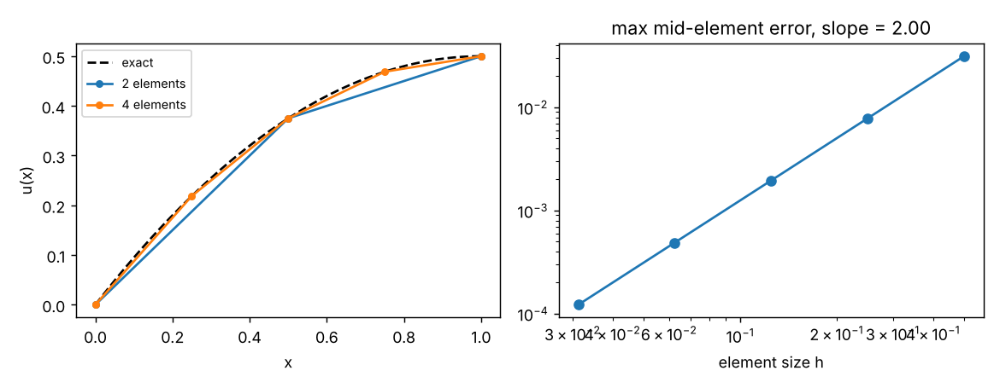
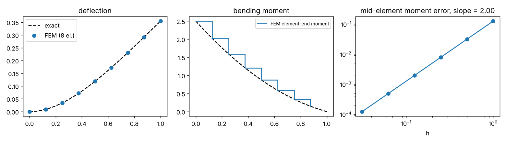
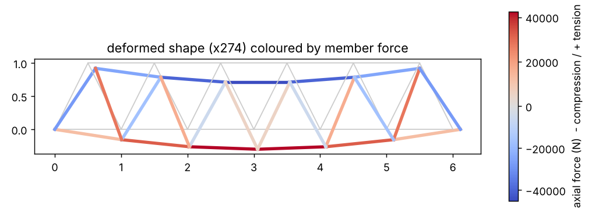
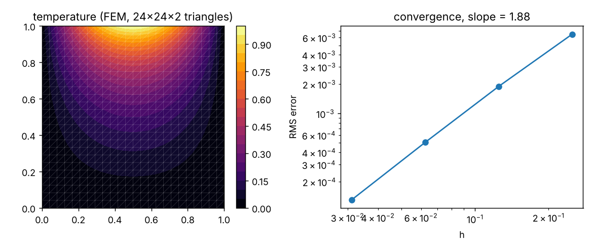

# fea-practice

유한요소법(FEM)을 라이브러리 없이 NumPy/SciPy로 직접 구현하며 연습한 기록입니다.
각 단계마다 **해석해(closed-form)와 비교해 검증**하고 수렴 차수를 확인했습니다.

*Finite-element exercises written from scratch, each verified against an analytical solution.*

| Step | Script | 요소 / Element | 검증 / Verification |
|---|---|---|---|
| 1 | `01_bar_1d.py` | 1-D 축하중 봉, 선형 요소 | 절점값 해석해와 일치, 요소 내부 오차 O(h²) |
| 2 | `02_beam_cantilever.py` | Euler–Bernoulli 외팔보, Hermite 요소 (처짐·회전각) | 끝단 처짐·뿌리 모멘트 해석해와 일치, 요소 중앙 모멘트 O(h²) |
| 3 | `03_truss_2d.py` | 2-D 트러스 (Warren 교량), 좌표변환·전체 강성 조립 | 반력 합 = 하중 합, 대칭 반력, 상현재 압축/하현재 인장 |
| 4 | `04_heat_2d.py` | 2-D 정상상태 열전도, 선형 삼각형 요소, 희소행렬 | 해석해 대비 RMS 오차 O(h^1.9) |






## 정리한 점 / Notes to self

- 경계조건은 고정 자유도를 제거(partitioning)하는 방식으로 처리 — 반력은 `K u − F`로 복원.
- 분포하중은 **consistent load vector**로 넣어야 보 요소에서 절점 처짐이 정확해진다.
- Hermite 보 요소는 요소 끝단 모멘트가 절점에서 정확하지만, 요소 내부 곡률은 선형이라
  중앙에서는 O(h²)로 수렴한다 — 응력 평가 위치를 고를 때 중요.
- 2-D 문제는 조립 시 `scipy.sparse`를 써야 요소 수가 늘어도 메모리·시간이 감당된다.
- 다음 단계에서 유체 하중과 구조 변형을 반복 계산하는 간단한 FSI(고정점 반복)로 확장할 계획.

## Next

- [ ] 대변형(기하 비선형) 보 — Newton–Raphson
- [ ] 2-D 평면응력 요소(CST/Q4)와 응력 집중
- [ ] 하중-구조 연성(fixed-point FSI) 및 형상 최적화와 결합

## Run

```bash
pip install -r requirements.txt
export PYTHONPATH=.
python 01_bar_1d.py && python 02_beam_cantilever.py && python 03_truss_2d.py && python 04_heat_2d.py
python -m pytest -q
```
